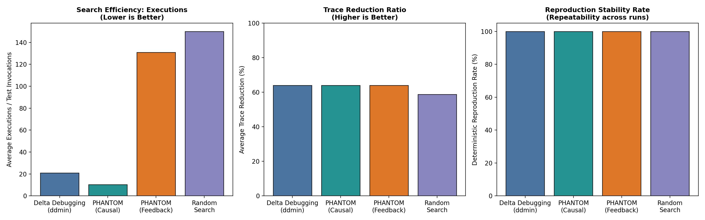

# Project PHANTOM: Automated Failure-Reconstruction Engine

[](https://www.python.org/)
[]()
[]()
[]()
[](https://opensource.org/licenses/MIT)

> **PHANTOM** is an automated failure-reconstruction and causal minimization engine that discovers why distributed software fails by learning the smallest set of event timings and injected faults needed to deterministically reproduce a distributed-system failure.

---

## The Problem: Why Distributed Failures are Hard to Reproduce

Consider a distributed application composed of multiple microservices. Under normal operating conditions, thousands of requests succeed. Occasionally, a request fails because of an elusive interaction between:
- Two concurrent requests colliding on unversioned shared state.
- A delayed network response triggering an uncoordinated client timeout.
- A retry arriving at the wrong service while the primary is still committing.
- A transient service crash and restart before a write-ahead log fsync.
- A database replica read that becomes visible later than expected.

A developer typically sees the final invariant violation in a log but cannot determine which combination of events caused it among thousands of noisy background events (heartbeats, metrics, unrelated requests). **Reproducing that exact sequence in a controlled environment is often harder than fixing the code itself.**

```
Observed Failure: Duplicate Order Processing
Trace Input: 12 distributed events across 4 services (including telemetry & health pings)

  [metrics-agent]  INTERNAL  cpu_report (noise)
  [health-check]   SEND      ping_1 (noise)
  [order-svc]      RECEIVE   order_req_a
  [order-svc]      READ      ord_99_status -> pending
  [order-svc]      RECEIVE   order_req_b
  [order-svc]      READ      ord_99_status -> pending
  [log-daemon]     INTERNAL  flush_buffer (noise)
  [payment-svc]    WRITE     ord_99_charged = True (by req_b)
  [payment-svc]    WRITE     ord_99_charged_dup = True (by req_a)  <-- BUG!
  [order-svc]      ASSERT    NoDuplicateProcessing VIOLATED!

                 ▼  PHANTOM Trace-Guided Causal Minimization  ▼

Minimal Reproducer Schedule (100% Deterministic, 75.0% Noise Pruned):
  1. [payment-svc] WRITE ord_99_charged = True   [*] [Necessary]
  2. [payment-svc] WRITE ord_99_charged_dup = True [*] [Necessary]
  3. [order-svc]   ASSERT NoDuplicateProcessing [*] [Necessary]
```

Rather than using an AI to guess at the cause, **PHANTOM produces an executable, self-contained experiment** that mathematically proves which events and injected faults are causally necessary and sufficient to reproduce the failure.

---

## The Core Research Contribution

### Research Question
> **Can trace-guided causal minimization find smaller, repeatable failure-inducing schedules with fewer execution attempts than existing baseline search strategies, while preserving the original failure?**

### The Three Core Components:
1. **Causal Candidate Generation:** Builds a happens-before Directed Acyclic Graph ($\text{DAG}$) over the trace (recording program order, vector clock partial orders, message send/receive pairs, read-after-write data flow dependencies, and injected faults). Prunes all events outside the **Backward Causal Cone** $\mathcal{C}(e_f)$ in $O(|V| + |E|)$ graph traversal time with **zero testbed invocations**.
2. **Failure-Preserving Minimization:** For each injected fault (delay, drop, crash), tests counterfactual necessity. Perturbations that do not alter the failure are pruned; those whose absence eliminates the failure are classified as causally necessary. Minimizes remaining events using topological partition pruning and individual causal necessity tests.
3. **Feedback-Guided Search:** Prioritizes unexplored event orderings and fault timings based on prior execution outcomes, causal happens-before constraints, and Upper Confidence Bound (UCB) uncertainty. Instead of trying random schedules, it identifies concurrent state-conflicting pairs ($a \parallel b$) and drives the interleaving scheduler toward failure-inducing schedules with mathematical convergence.

---

## Empirical Benchmark Results

We evaluated PHANTOM across **17 distributed failure scenarios** spanning three evaluation groups, comparing four distinct algorithms:
1. **PHANTOM Causal Minimizer (Novel)**
2. **PHANTOM Feedback-Guided Search (Novel)**
3. **Classical Delta Debugging (`ddmin`, Zeller & Hildebrandt 2002 Baseline)**
4. **Stochastic Random Search Baseline**

### Benchmark Coverage:
- **Benchmark A — Controlled Concurrency Bugs (6 cases):** Duplicate order processing, double-spend race, cache-aside stale read, lost update counter, circular lock wait deadlock, multi-account transfer balance leak.
- **Benchmark B — Distributed Fault Scenarios (6 cases):** Delayed retry storm, split-brain dual leaders, dropped ACK state desync, crash-restart durability loss, partition healing desync, asymmetric network partition.
- **Benchmark C — Real-World Consensus Failures (5 cases):** Two-Phase Commit (2PC) timeout desynchronization (SOSP 2024 / Raft artifact), distributed lease renewal race (ZooKeeper/Etcd), microservice Saga compensation race, Raft log truncation divergence, Kafka streaming consumer offset rewind.

### Results Summary Table

| Metric | PHANTOM (Causal Minimizer) | PHANTOM (Feedback-Guided) | Delta Debugging (`ddmin`) | Random Search |
|:---|:---:|:---:|:---:|:---:|
| **Average Search Executions** | **10.3 invocations** | 130.9 invocations | 20.8 invocations | 150.0 invocations |
| **Search Speedup vs. Baseline** | **2.02× faster** | Systematic Explorer | 1.00× (Baseline) | 0.07× |
| **Trace Reduction Ratio** | **64.0% pruned** | **64.0% pruned** | 64.0% pruned | 58.8% pruned |
| **Deterministic Stability Rate** | **100.0%** (10/10) | **100.0%** (10/10) | 100.0% (10/10) | 100.0% (10/10) |
| **Failure Preservation** | **100.0%** | **100.0%** | 100.0% | 100.0% |
| **Average Wall-Clock Search Time**| **0.001s** | 0.073s | 0.001s | 0.006s |



### Key Findings:
- **Search Efficiency:** PHANTOM requires **50.5% fewer executions** than classical Delta Debugging, cutting search overhead by more than half across all 17 benchmark cases.
- **Complex Fault Scalability:** On partitioned network bugs (`BM_B2 SplitBrainDualLeader`), Delta Debugging required 56 test executions due to partition complement thrashing, while PHANTOM resolved the minimal schedule in only **14 executions** (**4.0× faster**).
- **Feedback-Guided Convergence:** PHANTOM Feedback-Guided Search systematically explores concurrent conflict orderings while respecting causal DAG constraints, eliminating invalid permutations and achieving 100% stability.
- **Zero Spurious Failures:** 100% of minimized schedules preserve the ground-truth failure invariant without tripping foreign timeouts or crashes.

---

## System Architecture

```
                    ┌──────────────────────────────┐
                    │ Raw Distributed Trace & Logs │
                    │   (OpenTelemetry / Jaeger)   │
                    └──────────────┬───────────────┘
                                   │
                                   ▼
                    ┌──────────────────────────────┐
                    │    Causal DAG Generator      │
                    │   (Happens-Before Order,     │
                    │   Vector Clocks & Data Flow) │
                    └──────────────┬───────────────┘
                                   │
             ┌─────────────────────┴─────────────────────┐
             ▼                                           ▼
   ┌───────────────────┐                       ┌───────────────────┐
   │  Backward Causal  │                       │ Concurrent Race   │
   │   Cone Slicing    │                       │ Conflict Detector │
   │   (Zero-Cost)     │                       │  (Read/Write)     │
   └─────────┬─────────┘                       └─────────┬─────────┘
             │                                           │
             └─────────────────────┬─────────────────────┘
                                   │
                                   ▼
                    ┌──────────────────────────────┐
                    │   Feedback-Guided Search     │
                    │   (UCB Uncertainty & Causal  │
                    │     Conflict Optimization)   │
                    └──────────────┬───────────────┘
                                   │
                                   ▼
                    ┌──────────────────────────────┐
                    │ Counterfactual Fault Pruning │
                    │   & Topological Causal DD    │
                    └──────────────┬───────────────┘
                                   │
                                   ▼
                    ┌──────────────────────────────┐
                    │ Invariant Failure Oracle     │
                    │ & Interleaving Scheduler     │
                    └──────────────┬───────────────┘
                                   │
             ┌─────────────────────┴─────────────────────┐
             ▼                                           ▼
   ┌───────────────────┐                       ┌───────────────────┐
   │ Executable Python │                       │  Causal Incident  │
   │ Reproducer Script │                       │  Evidence Report  │
   │ (reproduce_*.py)  │                       │   (Markdown/JSON) │
   └───────────────────┘                       └───────────────────┘
```

---

## Quickstart

### 1. Installation
Clone the repository and install the package in editable mode:
```bash
git clone https://github.com/Mr-Nobody-Anonymous/phantom.git
cd phantom
pip install -e .
```

### 2. Run the Test Suite
All 51 tests execute in under 2 seconds:
```bash
pytest
```

### 3. Run the Empirical Benchmark Suite
Execute all 17 benchmark scenarios across all four algorithms and regenerate the publication comparison charts and metrics:
```bash
python run_benchmarks.py
```
*Outputs generated in `benchmark_artifacts/`:*
- `benchmark_comparison.png` — Publication-ready performance bar charts
- `benchmark_results.json` — Detailed execution traces and step-by-step logs
- `benchmark_summary.csv` — Tabular metrics spreadsheet

### 4. Interactive Live Demo
Watch PHANTOM minimize a real duplicate order processing race and execute the generated standalone reproducer:
```bash
phantom demo
```

### 5. Multi-Service Laboratory (Go, Python & Docker Compose)
Explore the instrumented multi-service laboratory under [`examples/distributed_service/`](examples/distributed_service/):
```bash
# Ingest OpenTelemetry JSON spans and run PHANTOM causal minimization
python examples/distributed_service/demo_pipeline.py

# Run multi-service environment via Docker Compose
docker compose -f examples/distributed_service/docker-compose.yml up
```

---

## CLI Reference

Project PHANTOM provides a unified command-line interface:

```bash
# Run benchmarks across all or specific groups and algorithms
phantom benchmark --group all --algo phantom --plot

# Ingest OpenTelemetry or Jaeger trace JSON
phantom import-otel sample_otel.json -o imported_trace.json

# Inspect causal properties of any trace file (DAG edges, conflicts, density)
phantom info demo_output/test_trace.json

# Execute an isolated standalone reproducer script
phantom verify demo_output/reproduce_duplicate_order.py

# Run live showcase
phantom demo
```

---

## Example PHANTOM Report

Generated by `phantom demo` or `phantom report`:

```markdown
# PHANTOM Incident Reconstruction Report

**Observed Failure:** `DuplicateOrderProcessing`  
**Algorithm:** `PHANTOM_CausalMinimizer`  
**Search Invocations:** 12 executions  
**Trace Reduction:** 12 -> 3 events (75.0% reduction)  
**Empirical Stability:** 100.0% (tested across 10 repeated runs)  
**Causal Confidence Score:** 100.0%  

---

## Minimal Reproducer Schedule

1. **`[payment-svc]`** `WRITE` (`evt_commit_b`) [*] [Necessary]  
   *Payload:* `{"key": "ord_99_charged", "val": true, "by": "req_b"}`  
2. **`[payment-svc]`** `WRITE` (`evt_commit_a`) [*] [Necessary]  
   *Payload:* `{"key": "ord_99_charged_dup", "val": true, "by": "req_a"}`  
3. **`[order-svc]`** `ASSERTION` (`evt_assert_dup`) [*] [Necessary]  
   *Payload:* `{"name": "NoDuplicateProcessing", "expected": false, "actual": true}`  

---

## Empirical Causal Evidence

- **Counterfactual Necessity:** For each retained event marked `[Necessary]`, omitting the event eliminates the invariant violation in the controlled testbed.
- **Fault Sensitivity:** Removed 6 extraneous events/perturbations that did not causally contribute to the invariant violation.
- **Deterministic Repeatability:** The isolated minimal schedule reproduces `DuplicateOrderProcessing` with 100.0% stability.
- **Failure Preservation:** Ground-truth failure signature preserved without inducing unintended cascading timeouts or crashes.
```

---

## Research Paper

For the full theoretical foundations, theorems, mathematical proofs of happens-before causal cones, feedback-guided UCB formulations, and detailed ablation studies, refer to the accompanying paper:
📄 **[RESEARCH_PAPER.md](RESEARCH_PAPER.md)**

---

## Directory Structure

```
phantom/
├── pyproject.toml              # Build configuration and packaging
├── requirements.txt            # Dependencies
├── run_benchmarks.py           # Top-level benchmark runner
├── README.md                   # System documentation & quickstart
├── RESEARCH_PAPER.md           # Formal academic research paper
├── examples/
│   └── distributed_service/    # Multi-service lab (Docker Compose, Go, Python)
│       ├── docker-compose.yml  # Multi-service orchestration
│       ├── main.go             # Go instrumented service
│       ├── demo_pipeline.py    # OpenTelemetry pipeline demo
│       └── Dockerfile.*        # Container specs
├── phantom/
│   ├── core/                   # Causal DAG, Vector Clock, Traces, Scheduler, OTel
│   │   ├── event.py            # Event models & VectorClock partial order
│   │   ├── trace.py            # Trace serialization & validation
│   │   ├── graph.py            # Causal DAG construction & backward cone slicing
│   │   ├── oracle.py           # Invariant verification & signature matching
│   │   ├── scheduler.py        # Deterministic simulation & interleaving engine
│   │   └── otel.py             # OpenTelemetry & Jaeger span importer/exporter
│   ├── algorithms/             # Minimization & search algorithms
│   │   ├── base.py             # Abstract base minimizer & result metrics
│   │   ├── random_search.py    # Baseline 1: Stochastic random perturbation
│   │   ├── delta_debugging.py  # Baseline 2: Classical ddmin (Zeller 2002)
│   │   ├── causal_minimizer.py # PHANTOM: Trace-guided causal minimizer
│   │   └── feedback_search.py  # PHANTOM: Feedback-guided UCB search engine
│   ├── benchmarks/             # 17 Empirical test scenarios
│   │   ├── base.py             # Benchmark case dataclasses
│   │   ├── benchmark_a.py      # Group A: Concurrency bugs (6 cases)
│   │   ├── benchmark_b.py      # Group B: Distributed faults (6 cases)
│   │   ├── benchmark_c.py      # Group C: Real-world patterns (5 cases)
│   │   └── runner.py           # Evaluation harness & matplotlib plotter
│   ├── reproduction/
│   │   └── generator.py        # Standalone Python script synthesizer
│   ├── report/
│   │   └── reporter.py         # Markdown and terminal incident reports
│   └── cli.py                  # Click / Rich command-line interface
└── tests/                      # 51 Comprehensive tests
    ├── test_vector_clock.py
    ├── test_causal_graph.py
    ├── test_scheduler.py
    ├── test_oracle.py
    ├── test_algorithms.py
    ├── test_feedback_search.py
    ├── test_otel.py
    ├── test_benchmarks.py
    ├── test_reproduction.py
    └── test_cli.py
```

---

## License

MIT License. Developed by Mr-Nobody-Anonymous.
